# CreatorOS Studio

**An open-source Higgsfield you run at home: one recurring character, from a one-line brief to a finished, edited reel.** Train the character, shoot photos, animate them with sound, move the camera, re-shoot an angle, restore old footage and cut it all together, on your own GPU, with open-weights models only, on top of a local [ComfyUI](https://github.com/comfyanonymous/ComfyUI).

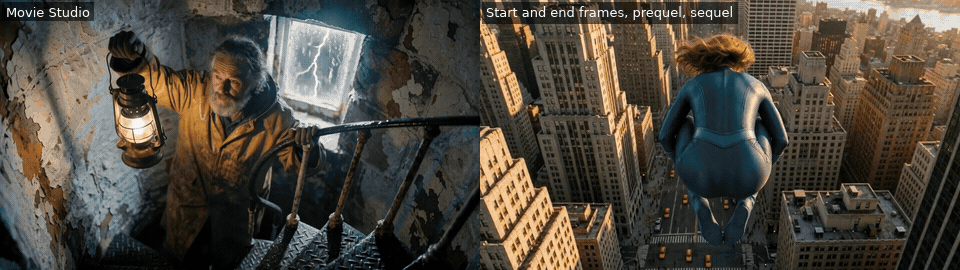

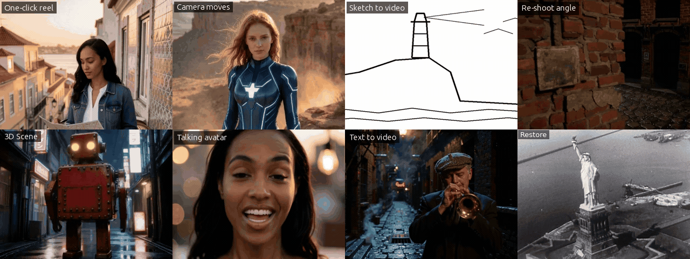

- **Try it now**: https://forge.taila06702.ts.net:8443 — the public demo runs on the author's RTX 5090, one render at a time, 12 images or clips per hour per visitor.
- **Demo video**: https://youtu.be/0muDKpkbcWw
- **Run it yourself**: see [Install](#install).

Built for the Comfy **#OpenSourceHiggsfield** challenge. Every model is open weights and runs locally: no API call, no credits, nothing leaves the machine.

## What is new here

- **Your character, trained in the UI.** Describe an adult, pick one of four faces, and the studio builds a reference sheet, twelve images and an identity LoRA. Or train from your own library images. Tick one or several engines (FLUX.2 Klein, Krea 2), see the estimated time before you start, follow the steps live and cancel at any point. The same face then carries every photo, clip and reel.
- **A brief becomes a finished reel.** A local LLM plans the shots of one session, each shot is photographed, animated with sound and edited with music, a hook, transitions and an optional voice-over cut on the beat. Redo one shot and only that one is re-rendered. The edit stays open in a real timeline editor.
- **Direct, don't prompt.** Block a shot in 3D Scene, film the same moment from a second camera (Re-shoot), draw a sketch and pick one of three interpretations, or fill a shot card (camera, lens, light, film stock) instead of writing a prompt.
- **Restore.** An old photo or a damaged clip comes back clean and in HD: scratches and noise removed, optional colour, detail rebuilt by SeedVR2, with a before / after slider against the original.
- **A public demo on a real GPU, with locks.** Anyone can try it live. The demo refuses anything involving a minor and any nudity, accepts visitor photos only when no person is in them (so no deepfake of a real person), keeps the owner's uploads private, every clip is checked automatically (black, frozen or jumping clips are re-shot once), and every render goes through a nudity detector (NudeNet, on the CPU): a positive is moved to a closed quarantine folder, never shown.
- **Nothing is a black box.** Every render downloads as the exact ComfyUI workflow it ran, with its models and their licences, so you can keep going in ComfyUI.

## Measured on one card

Every number below was measured on the author's machine on 3 November 2026: one **NVIDIA GeForce RTX 5090 (32 GB)**, ComfyUI 0.43, Ubuntu 26.04. Each function was re-run once from a real library render with all models unloaded first, so the *cold run* includes loading the models from disk. The *median* is taken over the real renders stored in the studio's database. *Peak VRAM* is the most the whole card held during the run: ComfyUI keeps models in memory while there is room and offloads to system RAM when there is not, so a peak near 32 GB means the card was filled, not that 32 GB is the minimum.

| Function | Models | Output | Cold run | Median (renders) | Peak VRAM |
|---|---|---|---|---|---|
| Photo | Krea 2 + character LoRA | 1080×1904 image | 17 s | 14 s (318) | 21.3 GB |
| Photo with references | FLUX.2 Klein 9B + LoRA | 1344×768 image | 9 s | 3 s (105) | 21.7 GB |
| Image to video, with sound | LTX-2.5 22B | 1600×896, 5 s | 135 s | 112 s (203) | 31.8 GB |
| Image to video | Wan 2.2 I2V A14B | 720×1280, 3 s | 147 s | 298 s (23, up to 8 s clips) | 26.5 GB |
| Re-shoot from a new angle | LTX-2.5 + CrossView-Warp IC-LoRA, MoGe-2 | 704×1280, 4 s | 161 s | 160 s (10) | 31.8 GB |
| 3D Scene to finished shot | LTX-2.5 + Layout-to-Render IC-LoRA, Qwen-Image-Edit | 1280×704, 5 s | 224 s | 175 s (8) | 31.8 GB |
| Remove people from a clip | LTX-2.5 + Clean-Plate IC-LoRA | 704×1280, 4 s | 132 s | 135 s (3) | 31.8 GB |
| Green screen / alpha | SAM3 | 704×1280, 4 s, WebM alpha | 15 s | 15 s (3) | 4.4 GB |
| Photo to 3D object | TRELLIS.2 + SAM3 | GLB + turntable | 25 s | 30 s (4) | 11.5 GB |
| Talking avatar | InfiniteTalk (Wan 2.1) | 480×832, 7 s | 141 s | 190 s (3) | 30.4 GB |
| Music | ACE-Step 1.5 turbo | track | 15 s | 9 s (9) | 24.5 GB |
| Restore photo: repair + colour | Qwen-Image-Edit 2511 | 840×1240 image | 50 s | 42 s (71 edits) | 30.3 GB |
| Restore photo: HD | SeedVR2 3B | 2048×3022 image | 12 s | 11 s (4) | 15.6 GB |
| Sharpen a clip to 1080p | SeedVR2 3B | 1920×1080, 4 s | 126 s | 127 s (4) | 27.3 GB |
| Restore a tiny clip (320×182) | SeedVR2 7B, two passes | 1756×1080, 4.8 s | 293 s | – | 28.2 GB |
| Train a character LoRA | ai-toolkit, FLUX.2 Klein | LoRA, 1,200 steps | 30 min | – | – |
| Train a character LoRA | ai-toolkit, Krea 2 | LoRA, 1,200 steps | 38 min | – | – |

On this machine the local LLM (Ollama) that rewrites prompts and plans reels runs on the CPU (`CREATOROS_LLM_GPU=0`), so it never competes with a render for VRAM; by default it uses the GPU when the card is free.

## What it does

- **One-click reel**: write a brief ("a Sunday morning in Paris, golden light"). A local LLM plans 3 to 6 shots of one session (same outfit, place and light), the character is photographed shot by shot, each shot is animated with sound (LTX-2.5), and the reel is edited automatically with fades, an opening hook and music. The edit stays open in the editor. Not happy with one shot? Redo only that one, with a new motion: the other clips stay and the reel is re-edited by itself. Two options: a **voice-over** (one first-person line per shot, written by the same LLM and spoken by Kokoro, with the music ducked under the voice) and **cut on the beat** (the track's tempo is measured with numpy and ffmpeg, every shot lasts a whole number of beats and every cut lands on one).
- **Camera & effects gallery**: 25 one-click presets on any photo: dolly in and out, jib up and down, side tracking, orbit, arc, crash zoom in and out, bullet time, dolly zoom… and viral effects (squish, inflate, cakeify, explode, robot reveal…). Camera moves use the LTX-2 camera LoRAs on LTX-2.5; the others use Remade-AI and ostris LoRAs on Wan 2.1. Jib down is chained in two renders: a jib up from the photo, then a Wan 2.2 first-and-last-frame move from its last frame back down to the photo.
- **Movie Studio**: a shot card instead of a prompt. Pick the camera body, lens, focal length and aperture, the framing, the light, the film stock, the look and the grade, add a colour palette (or pull one from a photo), start from a starter shot. Takes ×1 to ×4, or the same shot under four lights on the same seed. Your character plays the scene on Krea 2 or FLUX.2 Klein; any take animates in one click.
- **Sketch to video**: draw the scene in a few lines in the browser, say what it is and what moves. The drawing is reduced to its outlines (a real photo sent instead loses every face and texture), FLUX.2 Klein offers three interpretations that keep your composition, you pick one (larger preview on hover, then confirm), and LTX-2.5 animates it with sound. A scene with nobody in it stays empty: the character is only added when the sketch describes a person, and people keep two arms and two legs unless you ask otherwise.
- **3D Scene**: block a shot in real 3D. Place people, boxes and GLB objects in a top view, see the scene through the camera side by side with the set, set its height, aim and field of view at the start and end. The owner can import any `.glb`; every visitor can use the objects the studio generated. The server draws a grey layout from those numbers, Qwen Edit paints the first frame, and LTX-2.5 with Lightricks' Layout-to-Render IC-LoRA turns it into a finished shot that follows the blocking.
- **3D object**: a photo becomes a GLB in about a minute with TRELLIS.2 (MIT) on ComfyUI's core nodes. SAM3 isolates the object you name. View it in the browser, download it, or use it in 3D Scene.
- **Seamless loop**: one photo as first and last frame on Wan 2.2. Each loop gets a measured seam score.
- **Transparent background**: SAM3 keeps the person, a photo comes out as a PNG with alpha and a clip as a WebM with alpha, nothing is redrawn. The clip can then be exported as ProRes 4444 with alpha.
- **Masters**: any clip exports as HLG HEVC (10-bit Rec.2020), HLG ProRes 422 HQ or a zip of linear ACEScg half-float EXR frames, on the CPU with ffmpeg. These put an SDR clip in an HDR container: no highlight detail is invented.
- **Sharpen to 1080p**: SeedVR2 3B takes any clip up to 1080p, motion unchanged (about 2 min for 4 s on a 5090).
- **Restore**: an old photo or a damaged clip comes back clean and in HD. A photo is repaired first (scratches, dust, stains, faded areas, optional colourisation) by Qwen-Image-Edit with an instruction that keeps every face and the framing, then SeedVR2 rebuilds the fine detail up to 2048 px (about 1 min). A clip goes through the SeedVR2 7B model to 1080p with its sound (natural faces where the 3B turns skin waxy), black bars removed, in two passes when the source is tiny. The result opens in a before / after slider against the original. Visitors start from the library; the owner can also send a scan or an old video.
- **Next shot**: from one photo, Coverage makes a wide, a ¾ and a close-up, Push in moves closer, Next beat imagines the moment after.
- **Re-shoot**: pick a clip, pick an angle (left, right, three-quarter, high, low, or a sweep, descend or orbit move) and get the same moment filmed by a second camera, with the original sound. MoGe-2 reads the clip's geometry, the CrossViewWarp node reprojects it into the new view, and LTX-2.5 with the CrossView-Warp IC-LoRA fills in what the first camera never saw.
- **Dubbing**: give a clip a new voice. InfiniteTalk (Wan 2.1, ComfyUI core nodes) re-encodes the clip and partly re-noises it, so the scene and the gestures stay and the lips follow the new speech (the first 3.2 s of the clip per pass).
- **Voice-over**: type a line, pick one of seven voices, and Kokoro-82M (Apache-2.0) speaks it in a few seconds. The file joins the audio library, ready for the editor, the reel or dubbing. The owner can also **clone a voice** from a 5 to 20 s reference clip with Chatterbox (Resemble AI, MIT, Perth audio watermark), after confirming it is their own voice or that the person agreed. The owner can also **change the voice** of a recording or of a clip with Chatterbox VC: the words, rhythm and pauses stay, only the timbre changes (a studio voice, or a consented library clip as the target); for a clip, the picture is copied untouched and the new voice replaces the soundtrack.
- **Reframe a clip**: 9:16, 16:9, 1:1 or 4:5. Wan 2.2 Fun VACE (Apache-2.0, ComfyUI core nodes) sees the clip in the centre of the new frame and generates the missing edges frame by frame, continuing the set, the perspective and the motion. The original clip is then laid back in the centre at its own frame rate with its sound, and the seam is feathered.
- **Create a character from scratch**: describe an adult (age 21 to 80, origin, hair, eyes, style, distinctive features). Krea 2 offers four studio portraits; pick one and name it. The studio creates the character, a reference sheet (face, both profiles, back) and twelve varied images with FLUX.2 Klein, then trains its LoRA on them for the engines you tick. Leave the page and come back: the faces and the progress are still there. Owner only.
- **Ad pack**: one product photo gives five renders at once: an e-commerce packshot, a lifestyle scene, a poster with your headline (Qwen-Image-Edit 2511), your character presenting the product (FLUX.2 Klein with the photo as a reference) and a 4 s product clip orbiting the packshot (LTX-2.5).
- **Social check**: before you post, the local vision model looks at four frames of a clip and scores the hook, the subject, the image and the story, ffmpeg measures the length, format, sound and cuts, and you get three concrete tips. It is a quality estimate, not a prediction of views.
- **Extensions**: add functions without code. An extension is a ComfyUI workflow (API format) plus an `app.json` that describes its form; the studio checks that every node and model already exists in ComfyUI before running it, and never installs code. Two ship with the studio (Illustration, Ambient sound); the owner can install more from the catalogue. Write your own: [docs/EXTENSIONS.md](docs/EXTENSIONS.md). **Official ComfyUI workflows open as studio pages**: the studio converts a workflow from the template library (editor format, subgraphs and dynamic inputs included) to the API format, turns its prompt, images and seed into a form, and runs it like any other tool (252 of the 262 open templates convert).
- **Official ComfyUI workflows**: the Extensions page also lists the 262 open-source workflows that ship with ComfyUI, with the models each one is missing. The owner downloads them in one click, from the official address written in the workflow, and opens the workflow in ComfyUI. The owner can also **update ComfyUI in one click** (its official repository and requirements, torch untouched) and **install missing third-party nodes** from the ComfyUI-Manager node map (git clone + requirements; their install scripts are never run). The public demo refuses any third-party code; a local install allows it.
- **Train your character**: pick 8 to 30 library images of the character and a trigger word, then tick one or several engines: FLUX.2 Klein and Krea 2. ai-toolkit (ostris, MIT) trains each LoRA on your GPU, one after the other, and the studio shows the estimated time before you start, the live step count and the time left, with a cancel button. About 30 minutes (Klein) to 38 minutes (Krea 2) for 1,200 steps on a 5090. Each LoRA is attached to the character for its engine, and the trigger word is only added where a LoRA exists. Without a Klein LoRA, Klein uses the character's profile photo as a face reference instead. Owner only.
- **Talking avatar**: one photo plus a voice (an audio file or the microphone, up to 20 s); the character speaks with lips in sync (InfiniteTalk on Wan 2.1, chained block by block to the length of the audio). Or just type the line: LTX-2.5 makes the voice and the lip movement in a single 4 to 8 s render, no audio file needed (works best on a close shot).
- **Editor**: put library clips and photos on a timeline, trim them with the mouse, crop each shot, add cuts, crossfades or fades to black, text per shot and music, with a global timeline and a playhead. Between two shots, a **generated transition**: Wan 2.2 draws a continuous passage from the last frame of one shot to the first frame of the next, and the clip is inserted between them. Export renders on the CPU with ffmpeg as a library asset.
- **Photo**: text-to-image with Krea 2 (FLUX.2 Klein 9B, MOSS Image and FLUX 3 Image Klein optional). A local LLM (Ollama) rewrites the prompt first. Add up to six reference images from the library and FLUX.2 Klein carries the objects, clothes and places into the new photo. One-click presets build on them: **Try-on** (the character wears the outfit of the reference), **Product placement** (the character presents the product) and **Moodboard** (the references set the palette, light and texture, not the content).
- **Music and sound effects**: type a style, add lyrics if you want vocals, or describe a sound. ACE-Step 1.5 turbo (MIT) renders it in seconds, and the track lands in the music list of the editor and the reel.
- **Angles and looks on a photo**: one click shows the same photo from another camera position (¾ left or right, profile, from behind, high or low angle, wide, close-up) with the fal Multiple-Angles LoRA on Qwen-Image-Edit-2511, or turns it into one of 24 one-click looks (golden hour, night, burning sunset, film grade, skin retouch, pro headshot, beauty ad, plush toy, figurine, mascot, toy bricks, glitter sticker, comic, pixel art, clay, melting doodle, 60s café, giallo, movie poster, billboard, cloud surf, among animals, storm creature, evening outfit, product packshot, product scene, resume photo).
- **Light and frame on a photo**: seven one-click relights (left, right, window, studio, blue hour, neon, candle), and Expand widens a photo to 16:9, 9:16, 4:5, 1:1 or +30%: the edges are redrawn with Qwen-Image-Edit and the original photo stays untouched in the middle.
- **`@` in the prompt**: type `@` to pull in a character, outfit, place, pose or style. Picking a character makes it the active one.
- **Film a move on your phone** (owner only): scan a one-time QR code, film, and the clip lands in Motion as the source. The link expires after 10 minutes and takes one video.
- **Carousels**: from one anchor photo, the app plans a coherent set of shots (same character, same light, varied framing) and renders them as a batch.
- **Image-to-video**: Wan 2.2 I2V A14B or LTX-2.5 22B (with audio). Each engine has a quick low-resolution draft mode.
- **Motion transfer**: animate a still with the movement of a driver video (Wan Animate 2).
- **Change Background**: Qwen-Image-Edit redraws the first frame as the new place, Wan 2.2 Fun VACE redraws the place over the whole clip, and the person from the source is pasted back at the source resolution with a BiRefNet cut-out (hair strands, soft edges) limited to the area SAM3 tracks. On an RTX 50-series card BiRefNet needs torch and torchvision from the cu130 index (the cu129 torchvision has no Blackwell kernel for its deformable convolution).
- **Mix (character swap)**: give it a video, and your active character takes the place of the person in it, in the same setting and with the same moves. The studio picks the sharpest early frame, reads the outfit with the vision model and renders your character full-body in that outfit. **One person**: SCAIL-2 (Wan 2.1 14B, MIT) does the replacement with the official ComfyUI recipe (SAM3 tracking on both sides, 6 steps, about 3 minutes), keeping a sharp face and the light of the scene. **Two or three people**: WanAnimate 2.2 (SAM2 mask placed by GroundingDINO) with the character's Wan identity LoRA. A long video can start at any second of it, and every Mix states that the character stays fully clothed and refuses nudity. **Several people**: pick 2 or 3 characters, left to right. Each person gets their own pass on the result of the previous one, so people who cross paths can be mixed up.
- **Shot-by-shot rendering**: a driver video that contains cuts is split automatically at each cut. Every shot is rendered on its own, then the montage is rebuilt at the exact original durations. Rendering a multi-shot source in one block freezes the first shot's state; rendering per shot follows the source.
- **Brush retouch, photo and video**: paint a zone and describe the change. Only that zone is regenerated, and the rest stays byte-identical on photos. On video, the zone is either tracked frame to frame by SAM3 or kept fixed in the frame. The result opens in a before/after slider. No brush needed on video either: name an element ("dress") and say what it becomes, or **change the background**: Qwen-Image-Edit redraws the first frame in the new place, SAM3 tracks the person, Wan 2.2 Fun VACE rebuilds the whole background from that reference, and the person is pasted back from the source with a clean edge (no halo of the old place). **Place an object**: paint where it goes, pick a photo of the object and name it; SAM3 cuts it out and tracks the zone, the object is placed frame by frame and Wan blends it in (it stays in front of whatever passes it). **Green screen**: SAM3 tracks the person and everything else turns solid green, nothing redrawn. **Remove** people, passers-by or vehicles from a clip: the official LTX-2.5 Clean-Plate IC-LoRA by Lightricks rebuilds the empty scene behind them, camera move and original sound kept (about 2 min for 4 s).
- **Automatic clip check**: after every video render, the studio measures the clip in about a second, on the CPU: black frames, frozen video, a jump inside the shot, smear, and how close the face stays to the start image (OpenCV YuNet + SFace). A serious defect (black, frozen, jump, long smear) re-shoots the clip once with another seed. Both takes stay in the library, the one with fewer defects stays in front and the other is greyed out. Face drift and short blur are shown as warnings with the exact second. Re-shoot, avatar, video retouch and clean-plate clips are checked too, with warnings only.
- **Live preview** of the latent while a render is running (desktop and mobile).
- **Library**: review (approve/reject), folders, trash with restore, provenance of every render (recipe, seed, LoRAs, final prompt), and thumbnails for every grid. Every render can be downloaded as the **exact ComfyUI workflow** it ran (API format, server paths stripped) with the models it loads and their licences, to open it in ComfyUI and keep going there.
- **Diagnostics**: GPU/VRAM state, ComfyUI link watchdog, missing nodes and models per recipe, and a one-click **bug report log** (version, system, recent failures, browser errors, no private data) to paste into a GitHub issue.

Desktop UI (`src/v2`) and a mobile UI (`src/m`) are served by the same backend; the mobile Studio space carries the reel, cinematic studio, camera & effects, re-shoot, sketch to video, talking avatar, music and voice, editor, restore, ad pack, reframe, dubbing and social check views. The interface is in French and English.

## Screenshots

| | |
|---|---|
| 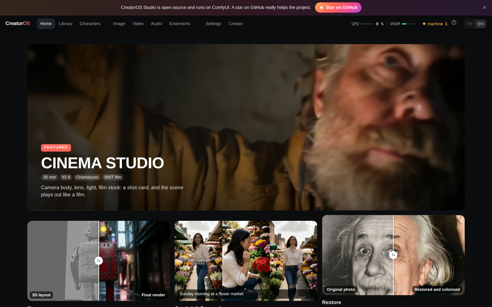 | 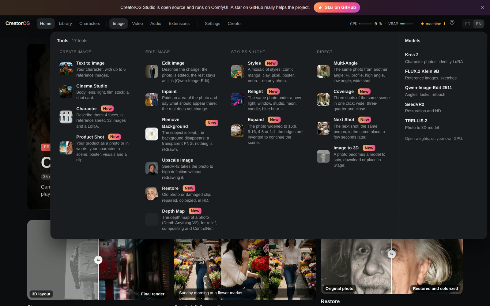 |
| **Home**: every tool shows a real render; Movie Studio featured | **Menus**: Image, Video, Audio and Extensions, with the names you know and the models behind them |
| 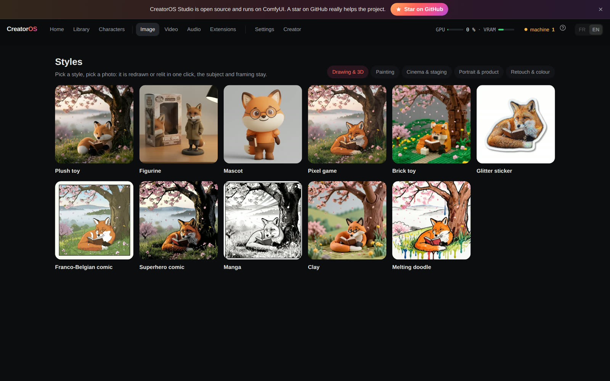 | 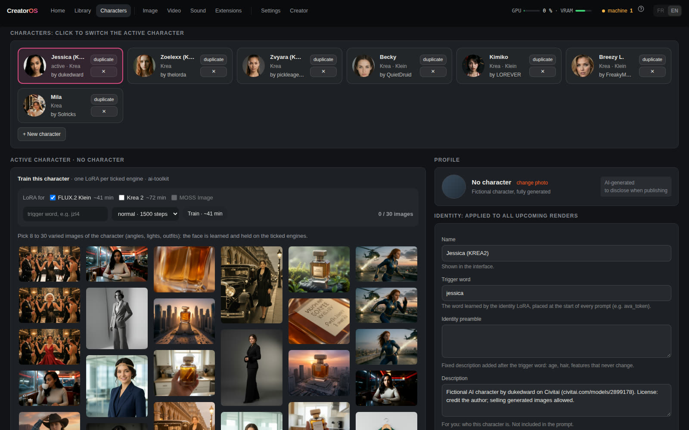 |
| **Styles**: 36 one-click looks, plus Relight and Expand mosaics | **Characters**: train a LoRA in the UI, profile, identity and voice |
| 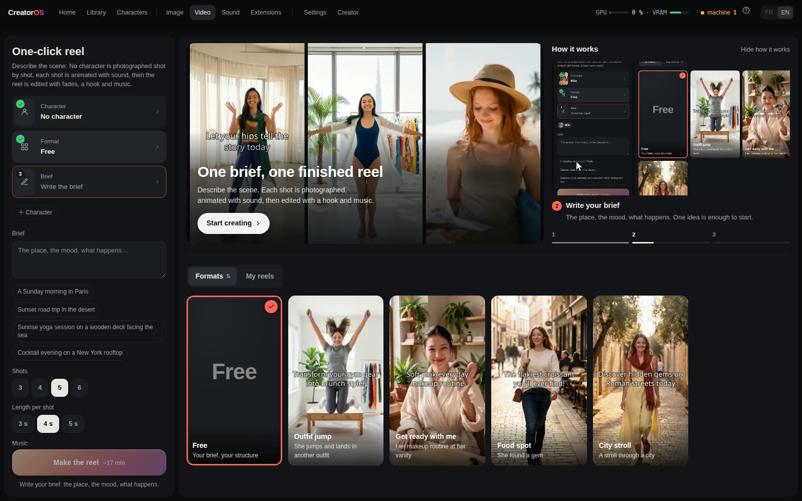 | 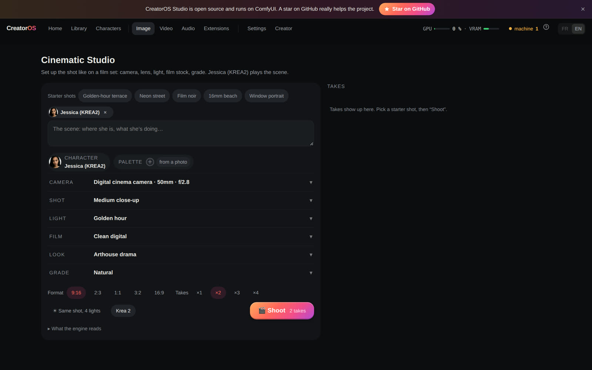 |
| **One-click reel**: brief, shots, clips, edit | **Movie Studio**: a shot card instead of a prompt |
| 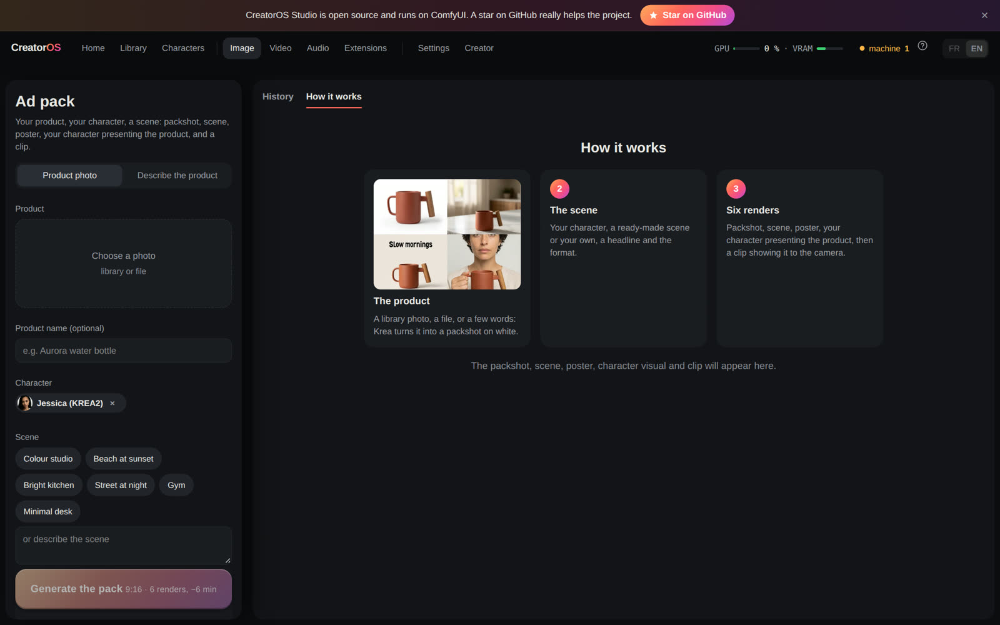 | 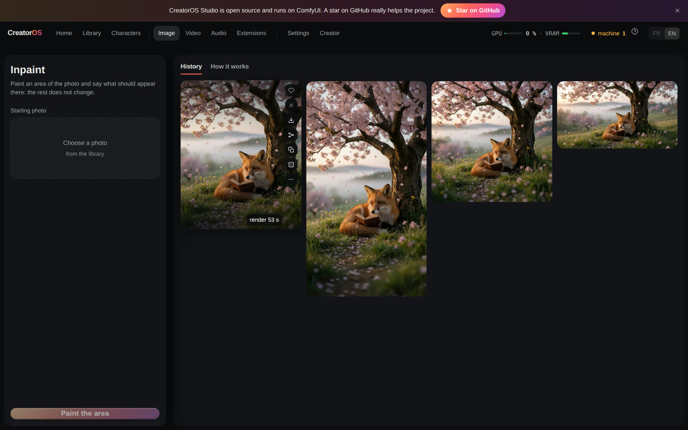 |
| **Product Shot**: packshot, scene, poster, your character with the product, a clip | **A page per tool**: source on the left, how it works and every past render on the right |
| 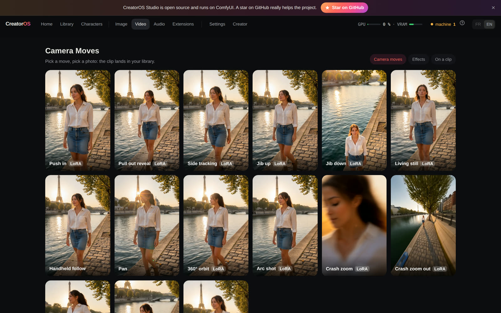 | 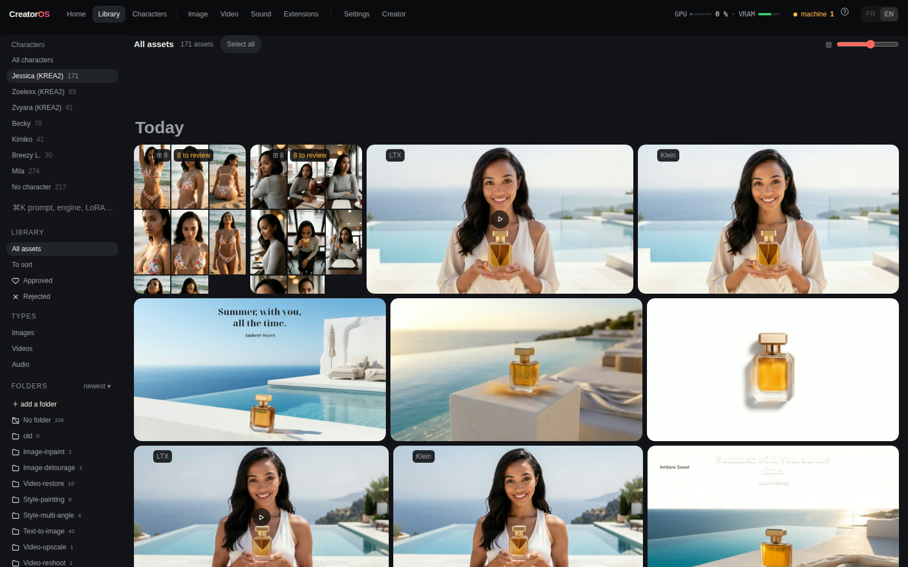 |
| **Camera Moves & Effects**: pick a move, pick a photo | **Library**: folders, characters, images, videos and audio |
| 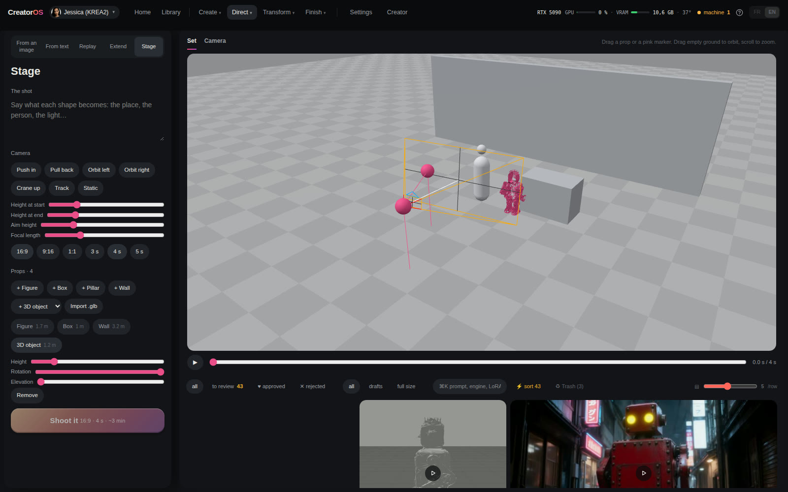 | 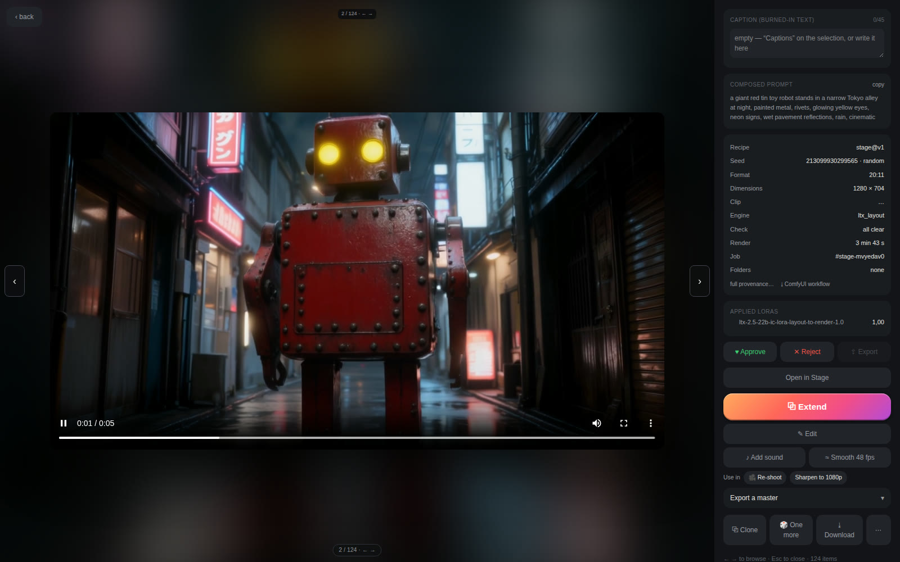 |
| **3D Scene**: block a shot on a 3D set, scrub the camera, get a finished shot | **Viewer**: full recipe, seed, render time, checks, ComfyUI workflow |
| 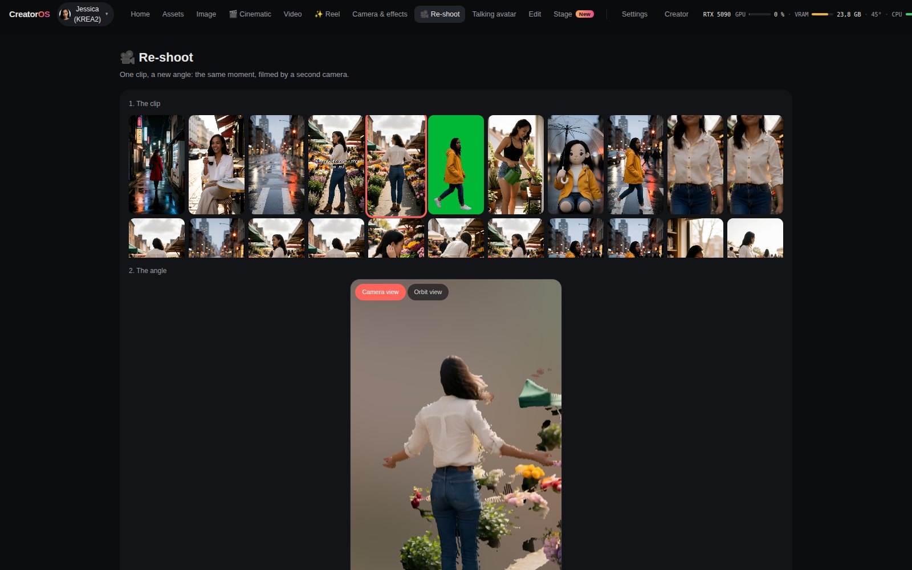 | 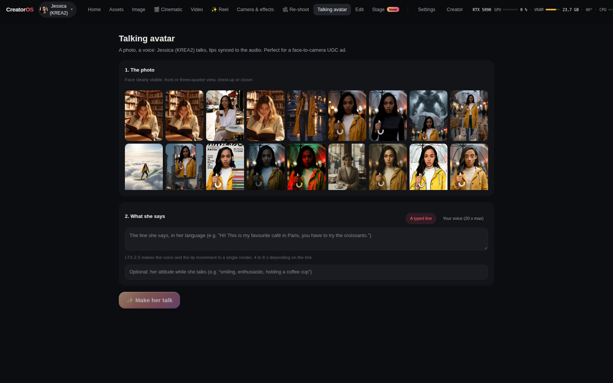 |
| **Re-shoot**: the same moment from a new camera angle, previewed in 3D | **Talking avatar**: one photo, one voice |

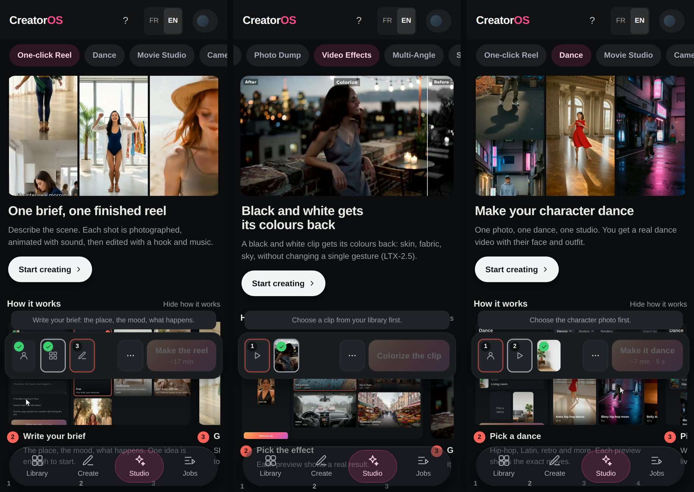

## Architecture

```
browser (desktop / mobile)
        │  HTTP
        ▼
Node (Fastify) server  ── server/          job queue, recipes, persona, SQLite
        │  HTTP + WebSocket
        ▼
ComfyUI (local)        ── workflows/       API-format recipes, patched per job
        │
Ollama (local)         prompt rewriting, captions, light vision checks
```

- **Recipes** are ComfyUI workflows in API format (`workflows/PROD_*.json`). The server loads a recipe, patches it for the job (prompt, seed, size, LoRAs, masks), then submits it. Patching happens in memory: a job never changes a recipe file. To swap in your own graph, open **Settings → Recipes & texts**, pick the recipe, click **Import an API workflow** and choose a ComfyUI export made with *Save (API)*. The file is loaded into the editor for review, and saving it validates the graph and backs up the previous version to `.backups/`. The *Review* panel then shows which inputs the server drives and which nodes or models are missing.
- **Shaping texts** (the rewriter system prompts, captions) live in `prompts/`. They are read at every job, so you can edit them without a restart.
- **Data** (SQLite database, renders, thumbnails) lives outside the repository, in `~/creatoros-data` by default.

## Requirements

- An NVIDIA GPU. The production machine uses a 32 GB card and the full-size recipes are sized for it; on 12 and 16 GB cards the photo recipes run with lighter weights (see [Smaller GPUs](#smaller-gpus)).
- Node.js 22.5 or newer (the server uses the built-in `node:sqlite`) and ffmpeg.
- [ComfyUI](https://github.com/comfyanonymous/ComfyUI), recent enough to ship the Wan Animate 2, LTX-2.5 and SAM3 core nodes, plus these custom node packs:
  ComfyUI-KJNodes, ComfyUI-VideoHelperSuite, ComfyUI-GGUF, ComfyUI-CrossViewWarp (re-shoot), ComfyUI-WanVideoWrapper + ComfyUI-segment-anything-2 + comfyui_controlnet_aux + comfyui_segment_anything (Mix), ComfyUI-Frame-Interpolation (RIFE, for video refine and smoothing), RES4LYF, ComfyUI-Impact-Pack + Impact-Subpack (only for photo HD).
- [Ollama](https://ollama.com) with a text model (default `mistral-small`) and a vision model (default `qwen2.5vl:7b`).

### Models

Each recipe names its model files. Open the JSON to see exactly what it loads. The main ones:

| Recipe | Models |
|---|---|
| `PROD_gen_krea_sfw.json` | Krea 2 turbo, Qwen3-VL 4B text encoder, Qwen-Image VAE |
| `PROD_gen_sfw.json` | FLUX.2 Klein 9B, Qwen3 8B text encoder, FLUX.2 VAE |
| `PROD_gen_moss_sfw.json` | MOSS Image SFT (int8), Qwen3.5 9B text encoder, FLUX.2 VAE. Apache-2.0, no identity LoRA, needs a recent ComfyUI (tested on 0.43) |
| `PROD_gen_flux3_sfw.json` | FLUX 3 Image Klein (distilled, int8, 16 steps), Qwen3-VL 4B text encoder, FLUX.2 VAE. FLUX Kommunity License (non-commercial, or commercial under US$5M revenue with a content filter); weights from `black-forest-labs/flux-3-image-klein-comfy` after accepting the licence on Hugging Face; no identity LoRA |
| `PROD_edit.json` | Qwen-Image-Edit 2511, Qwen2.5-VL 7B, Qwen-Image VAE |
| `PROD_video_wan*.json` | Wan 2.2 I2V 14B high/low noise, UMT5-XXL, Wan 2.1 VAE, lightx2v 4-step LoRAs |
| `PROD_video_wan_t2v.json` | Wan 2.2 T2V 14B high noise (fp8) and low noise (GGUF Q8), UMT5-XXL, Wan 2.1 VAE, lightx2v T2V LoRA |
| `PROD_video_ltx_hq.json` | LTX-2.5 22B distilled, Gemma text encoder, LTX video/audio VAEs, spatial upscaler |
| `PROD_motion_*.json` | Wan Animate 2, UMT5-XXL, CLIP Vision H, Wan 2.1 VAE, lightx2v distill LoRA |
| `PROD_wananimate_mix.json` | Wan 2.2 Animate 14B (fp8, Kijai), UMT5-XXL, CLIP Vision H, Wan 2.1 VAE, lightx2v distill LoRA, SAM2, DWPose, GroundingDINO |
| `PROD_v2v_refine*.json` | Wan 2.2 T2V A14B low noise (GGUF Q8), SAM3.1 for tracked zones |
| `PROD_video_wan21_effets.json` | Wan 2.1 I2V 14B 480p (fp8), UMT5-XXL, CLIP Vision H, Wan 2.1 VAE, lightx2v I2V 480p LoRA; effect and camera LoRAs added at render time |
| talking avatar (built in `server/jobs.js`) | Wan 2.1 I2V 14B 480p, InfiniteTalk single-speaker patch, wav2vec2 Chinese base audio encoder, lightx2v I2V 480p LoRA |
| 3D object (built in `server/jobs.js`) | TRELLIS.2 int8, DINOv3 ViT-L, TRELLIS.2 shape and texture VAEs, SAM3.1 |
| music and sound (built in `server/jobs.js`) | ACE-Step 1.5 turbo, Qwen 0.6B and 4B ACE encoders, ACE 1.5 VAE |
| re-shoot (built in `server/jobs.js`) | MoGe-2 ViT-L (geometry), LTX-2.5 22B distilled with the CrossView-Warp v2 IC-LoRA, Gemma text encoder, LTX video/audio VAEs, spatial upscaler |

Preset LoRAs (licences in `server/presets.js` and `scripts/installer/modeles.json`): LTX-2 19B camera control by Lightricks (LTX-2 Community License), camera and effect LoRAs by Remade-AI and the dolly zoom by ostris (Apache-2.0). The LTX-2 camera LoRAs load on LTX-2.5 unchanged. Re-shoot uses the [CrossView-Warp v2 IC-LoRA](https://huggingface.co/Cseti/LTX2.3-22B_IC-LoRA-CrossView-Warp_v2) and the [ComfyUI-CrossViewWarp](https://github.com/cseti007/ComfyUI-CrossViewWarp) node by Cseti (Apache-2.0), trained on LTX-2.3 and loading on LTX-2.5, and [MoGe-2](https://huggingface.co/Comfy-Org/MoGe) (MIT). The MiniMax H3 port of that LoRA is not used: its licence excludes the EU, the UK and the US.

## Install

```bash
git clone <this repo> creatoros-studio && cd creatoros-studio
npm run setup          # interactive wizard, see below
npm ci
npm run build          # type-check, build the front, precompress assets
npm start              # serves http://127.0.0.1:8787
```

ComfyUI is expected at `http://127.0.0.1:8188` and Ollama at `http://127.0.0.1:11434`.

### Setup wizard

`npm run setup` (plain Node, no extra dependency) walks through the machine and asks before every step that writes anything:

1. **Prerequisites**: Node 22.5+, git, ffmpeg, Python 3.12 (uv if present), NVIDIA driver and VRAM, with a fix hint for each missing piece.
2. **ComfyUI**: found through `COMFY_DIR`, `~/ComfyUI` or a path you give. If absent, it can clone it, create a venv (uv or `python -m venv`), install a CUDA build of PyTorch matching your driver, then the requirements. It checks that ComfyUI is recent enough for the core nodes the recipes use.
3. **Features**: pick what you want to run (photo, Klein, photo HD, edit, Wan, Wan T2V, LTX, motion, video retouch). Each group shows what is missing, its size, and an estimate of the VRAM it needs against your card (fits, tight, or likely too big).
4. **Custom node packs** the selected groups need, cloned into `custom_nodes/` with their requirements installed into ComfyUI's venv (torch lines are skipped so your CUDA build stays).
5. **Models**: downloaded into `models/` (or the default folder of your `extra_model_paths.yaml`), with progress and resume. Files are written as `.part` and renamed when complete.
6. **Ollama**: checks the service and offers `ollama pull` for `CREATOROS_LLM` and `CREATOROS_VLM_DESCRIBE`.
7. **Character**: optionally creates `<CREATOROS_DATA>/persona.json` from the example.

```bash
npm run setup -- --check         # report only, change nothing (alias --dry-run)
npm run setup -- --verify-urls   # HEAD every model URL, compare sizes, no download
npm run setup -- --comfy ~/ComfyUI --groups photo,video_wan
```

The model list lives in `scripts/installer/modeles.json` (target folder, URL, size, licence, recipes). The wizard re-reads `workflows/PROD_*.json` on every run and warns about any model a recipe loads that the manifest does not know. FLUX.2 Klein and LTX-2.5 come from gated Hugging Face repos: accept the licence on the model page, then `export HF_TOKEN=...` before running setup. The token is only sent as an `Authorization` header to huggingface.co, never printed or written. Restart ComfyUI after new node packs are installed.

### Smaller GPUs

The recipes stay the same on a smaller card; only the weights change. Below 24 GB, the studio swaps each heavy model loader for a lighter version of the same model just before the graph goes to ComfyUI: FLUX.2 Klein 4B instead of 9B, with its 4B text encoder. Video is not there yet: Wan 2.2 A14B as GGUF Q4 ran out of memory on the same 12 GB test at the recipe's resolution, so it is not listed. A variant is used only when its file is installed; otherwise the original runs and ComfyUI offloads it, more slowly. Krea 2 (13 GB) has no smaller version, so under 14 GB the default photo engine becomes FLUX.2 Klein. Character LoRAs trained on Klein 9B do not apply to the 4B, so on a 12 GB card a character keeps her look only through the prompt.

The profile (24, 16, 12 or 8 GB) comes from the card ComfyUI reports, or from `CREATOROS_VRAM`. The setup wizard reads the same profile and downloads only the light files your card needs (`npm run setup -- --vram 12` to size it for another card, `--keep-full` to also keep the originals). The machine panel shows the profile and which light weights are installed. The variants live in `scripts/installer/modeles.json` (`leger` entries), one list for the wizard and the server.

Only variants that passed the lab are listed. [docs/LAB.md](docs/LAB.md) gives the real render time and peak VRAM of each recipe, full-size on a 32 GB card and light on a ComfyUI limited to about 12 GB.

### Configuration

All settings are environment variables. The main ones:

| Variable | Default | |
|---|---|---|
| `CREATOROS_PORT` / `CREATOROS_HOST` | `8787` / `127.0.0.1` | HTTP server |
| `CREATOROS_DATA` | `~/creatoros-data` | database, renders, thumbnails, `persona.json` |
| `COMFY_URL` | `http://127.0.0.1:8188` | ComfyUI |
| `COMFY_DIR` | `~/ComfyUI` | used to locate `input/` and `output/` |
| `COMFY_INPUT` / `COMFY_OUTPUT` | `$COMFY_DIR/input` / `output` | |
| `CREATOROS_LORAS` | `$COMFY_DIR/models/loras` | LoRA folder listed in the UI |
| `OLLAMA_URL` | `http://127.0.0.1:11434` | |
| `CREATOROS_LLM` / `CREATOROS_VLM_DESCRIBE` | `mistral-small:latest` / `qwen2.5vl:7b` | |
| `CREATOROS_PHOTO_ENGINE` | `krea` | `krea` or `klein` |
| `CREATOROS_OWNER_KEY` | unset | locks the studio for a public demo, see below |
| `CREATOROS_VOIX_PYTHON` | `$CREATOROS_DATA/voix-venv/bin/python` | Python with `kokoro` installed, for voice-over and dubbing voices |
| `CREATOROS_AI_TOOLKIT` | `~/ai-toolkit` | ai-toolkit folder, for character training |
| `CREATOROS_NOTIF_URL` | unset | [ntfy](https://ntfy.sh) topic URL: the owner is notified when an Internet visitor starts a render, and when one fails or is refused |

### Optional extras

- **Voice-over**: `uv venv -p 3.12 $CREATOROS_DATA/voix-venv && VIRTUAL_ENV=$CREATOROS_DATA/voix-venv uv pip install "kokoro>=0.9.4" soundfile` (the English model downloads on first use).
- **Voice cloning**: `uv venv -p 3.11 $CREATOROS_DATA/clone-venv && VIRTUAL_ENV=$CREATOROS_DATA/clone-venv uv pip install chatterbox-tts`; on an RTX 50-series card, then install torch and torchaudio 2.8 from the cu128 index.
- **Character training**: install [ai-toolkit](https://github.com/ostris/ai-toolkit) in `~/ai-toolkit` with its own venv; the studio runs it as a job and frees ComfyUI's VRAM first.
- **MiniMax H3**: the studio is wired for it, but its weights are not shipped: the MiniMax H3 licence grants nothing in the EU, the UK, South Korea or the USA. If your region is allowed, add the five files in Settings > Optional models. The public demo, hosted in the EU, never offers it.

### Your character

The studio is built around one recurring character, described in `<CREATOROS_DATA>/persona.json` (copy `persona.example.json`):

```json
{
  "name": "Ava",
  "trigger": "ava_token",
  "description": "Fictional travel and lifestyle creator.",
  "preamble": "a 30-year-old woman with short auburn hair",
  "loras": [{ "name": "ava_krea.safetensors", "strength": 1.0 }],
  "videoLoras": []
}
```

The server stacks the character's LoRAs onto each job at render time; the recipes themselves contain none. Without a `persona.json`, the app runs on the base models with no trigger word. Each field can also be set by environment variable (`CREATOROS_PERSONA_NAME`, `_TRIGGER`, `_DESCRIPTION`, `_PREAMBLE`, `_LORAS` as `file[:strength],…`). The file is re-read when it changes.

Only use a character you own: a fictional one you created, or yourself.

### Public demo

Set `CREATOROS_OWNER_KEY` to a long random string before opening the studio to visitors. With a key, the Creator page, the characters and their wardrobe, LoRA uploads, profile photos, recipes and shaping texts are read-only: those writes answer 403 unless the request carries the exact key in an `X-Owner-Key` header. The owner enters the key once in Settings → Comfy Cloud; it stays in that browser. Visitors keep rendering, reviewing, editing and exporting. Without a key nothing is locked, which suits a single-user install.

Internet visitors (anyone without the key and outside the tailnet) are limited to 12 images or clips per hour each (a ×4 take counts as 4, a one-click reel as about 10), and are turned away while the public queue holds 8 jobs. A queued job shows its rank and an estimated start time. Settings → Comfy Cloud gives the owner a daily count of visitors, page views and renders, which keeps nothing personal: a visitor is a salted hash that changes every day. It also lists the latest visitor renders with their outcome and failure cause.

Visitors start from images the studio generated itself, or from a photo they upload **with no person in it** (an object, a product, a place, an animal). Each visitor photo is re-encoded without metadata (no GPS position kept), then checked on the CPU by GroundingDINO (person, face, child, hand, photographed or drawn), OpenCV YuNet (faces) and NudeNet (any body part); a single signal refuses it, and a refused photo is moved to the closed quarantine folder, never served. Six photos per hour per visitor. Uploading videos, voices or music stays owner-only, and the server refuses any job that points at the owner's uploads, even when the request is crafted by hand. Every text a visitor sends is checked raw, before the LLM rewrites it, and again after rewriting. Anything that refers to a child or a minor age is refused (English and French, ages in digits or words, disguised spellings), along with sexual content. A visitor refused for this is blocked from rendering for the rest of the day, and the owner is notified.

ComfyUI's `input/` folder may be shared with another install on the same machine. The studio keeps a register of the files it put there itself: the source picker only lists those, and a job or an image description that names any other file is refused. No JSON response shows the server's home folder; it is replaced by `~`.

### Use it from a terminal or an AI agent

The studio has a command line and an MCP server. Both talk to a running studio over its HTTP API, so the same rules apply as in the web UI: content filter, render queue, visitor limits.

```bash
npm run studio -- photo "a woman reading by a sunny library window, candid" --wait --out ./renders
npm run studio -- video <libraryId> "she turns a page, slow push-in" --wait
npm run studio -- reel "Sunday morning at a flower market" --shots 4 --wait --out ./renders
npm run studio -- status <jobId|reelId>
npm run studio -- library --n 5 --json
```

`--json` prints one JSON object per result, for scripts and agents. To let Claude Code, Claude Desktop, Cursor or any MCP client drive the studio:

```bash
claude mcp add creatoros-studio -- node /path/to/creatoros-studio/scripts/agent/mcp.mjs
# or, after `npm link` in the repo: claude mcp add creatoros-studio -- creatoros-studio-mcp
```

The MCP server exposes `generate_photo`, `image_to_video`, `make_reel`, `get_status`, `list_library`, `list_characters` and `machine_status`. It has no dependency beyond Node. Set `STUDIO_URL` if the studio is not on `http://127.0.0.1:8787`, and `CREATOROS_OWNER_KEY` if it is locked with an owner key. Without the key, a request from the same machine is treated like any visitor.

## Community

Shared on Reddit the week of the submission (numbers as of 28 October 2026):

| Community | Views | Upvotes | Comments | Shares |
|---|---|---|---|---|
| r/comfyui | 34,000 | 98 | 27 | 45 |
| r/StableDiffusion | 22,000 | 43 | 14 | 12 |
| r/OpenSourceAI, r/SelfHostedAI | 1,000 | 3 | 1 | 0 |

What people asked for, and what changed because of it:

- **"Can you swap your own workflows in?"** → Settings → Recipes & texts now has an *Import an API workflow* button (see Architecture).
- **"What about 8 GB of VRAM?"** (the most upvoted question) → lighter presets for smaller cards are the next step; until then the README says plainly that the recipes are sized for 32 GB.
- **"Does it run on several GPUs?"** → one studio per GPU works today (each with its own port, data folder and ComfyUI); a single queue feeding several cards is planned.
- **"The provenance tracking alone is a killer feature"** → every render keeps its recipe, seed, LoRAs and final prompt, and now also its automatic clip check.

A fork built around reference-driven video has been announced. Forks are welcome: the license is Apache-2.0, keep the notice and a credit.

## Content policy

This edition is general-audience only. Every job runs with a single SFW register, the rewriter instructions keep the character fully clothed, and a blocklist (`server/t0.js`) rejects prompts and captions with forbidden terms before anything reaches the GPU. Every render of a character also states that she is an adult woman in her mid-twenties, so a prompt that names no person cannot drift towards a younger-looking figure.

## Characters in the demo

The demo video and screenshots use fictional AI characters whose LoRAs are published on Civitai under licences that allow it: **Mila**, LoRA by [Solricks](https://civitai.com/models/2809908), and **Aisha**, LoRA by [KelevraQuakenstein](https://civitai.com/models/2327289) (credit required). **Ava** was created in the app for the video, with no LoRA. No real person's likeness is used.

## License

Apache License 2.0, see [LICENSE](LICENSE). Models, ComfyUI and custom node packs keep their own licenses.
