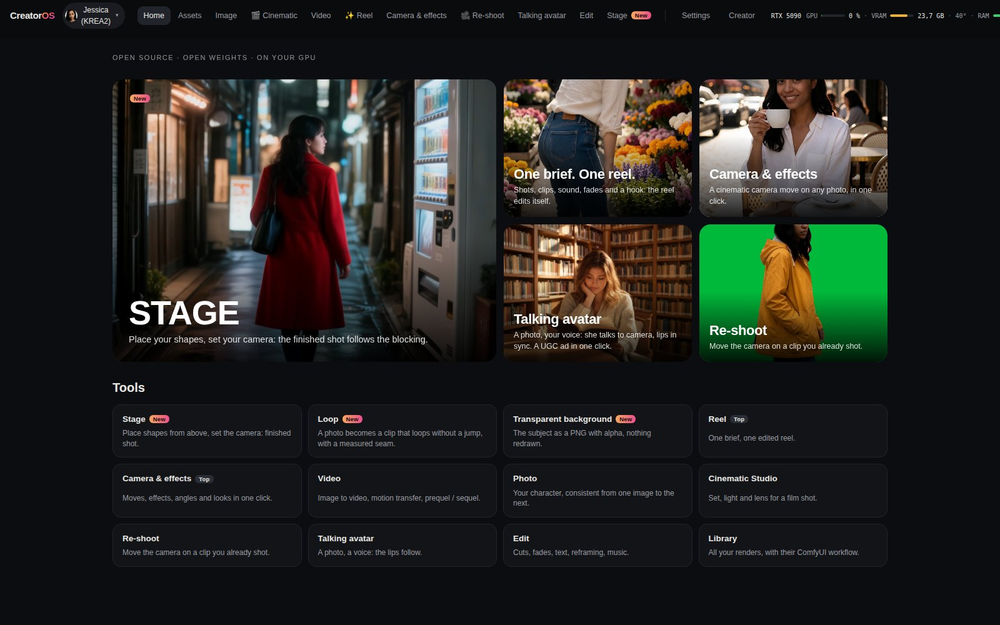
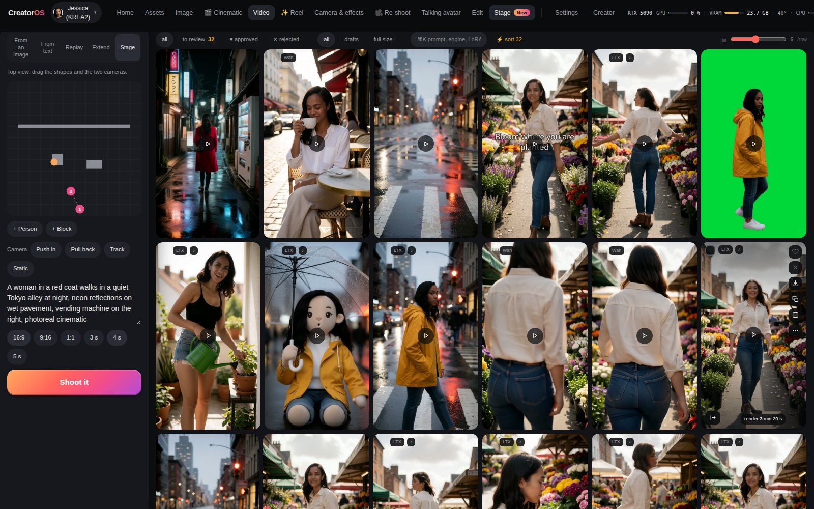
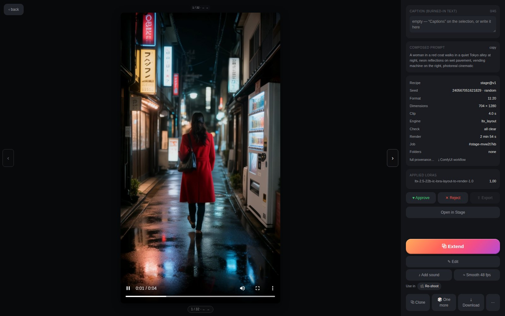
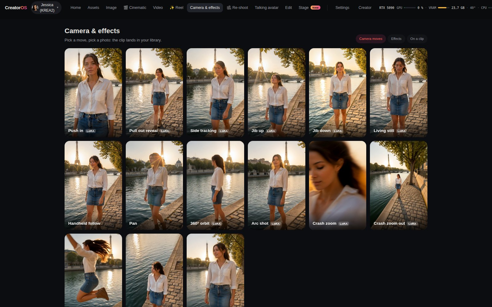
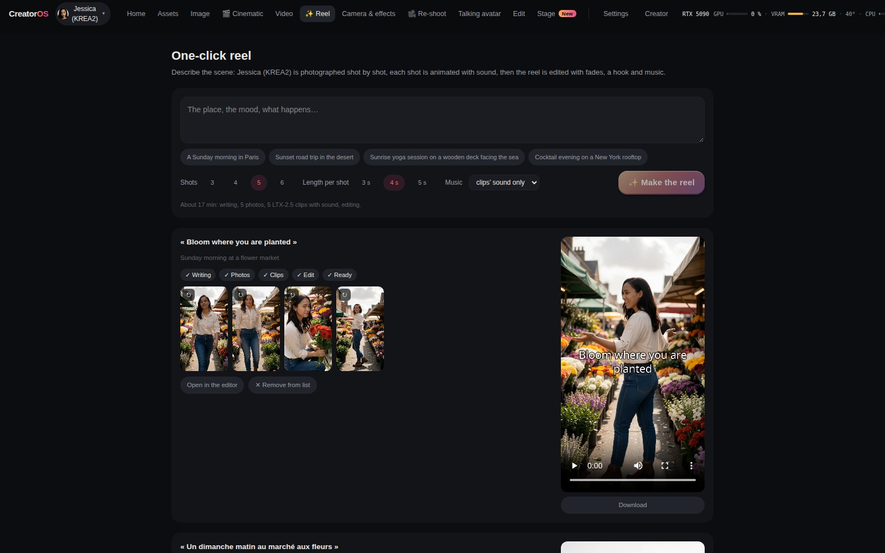
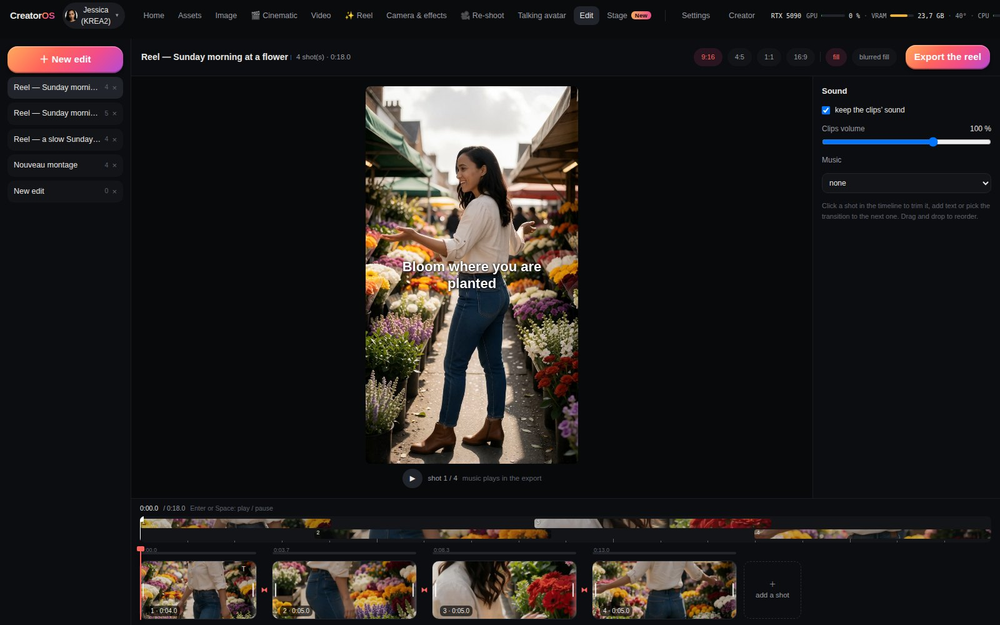
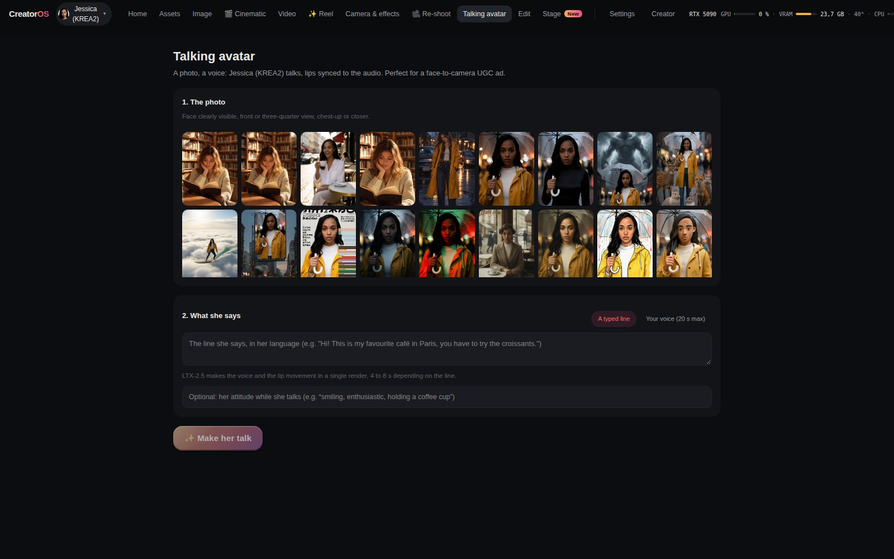
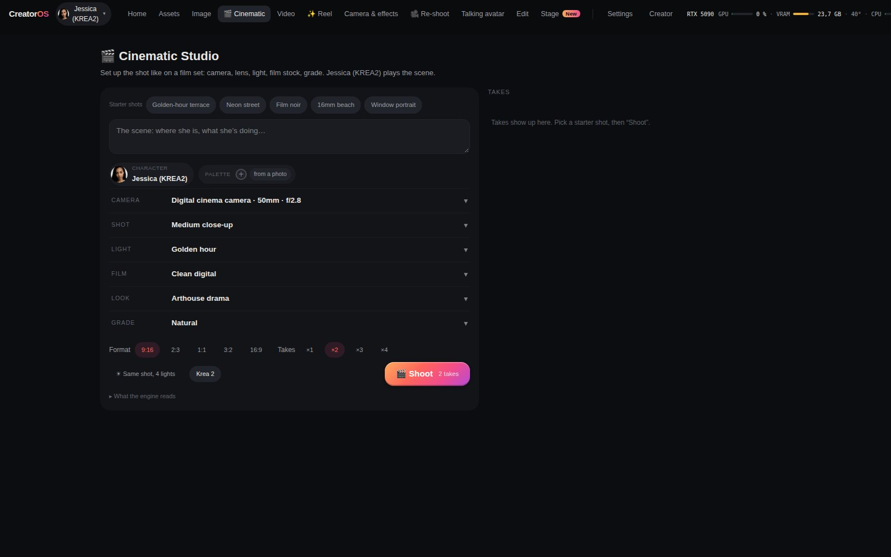
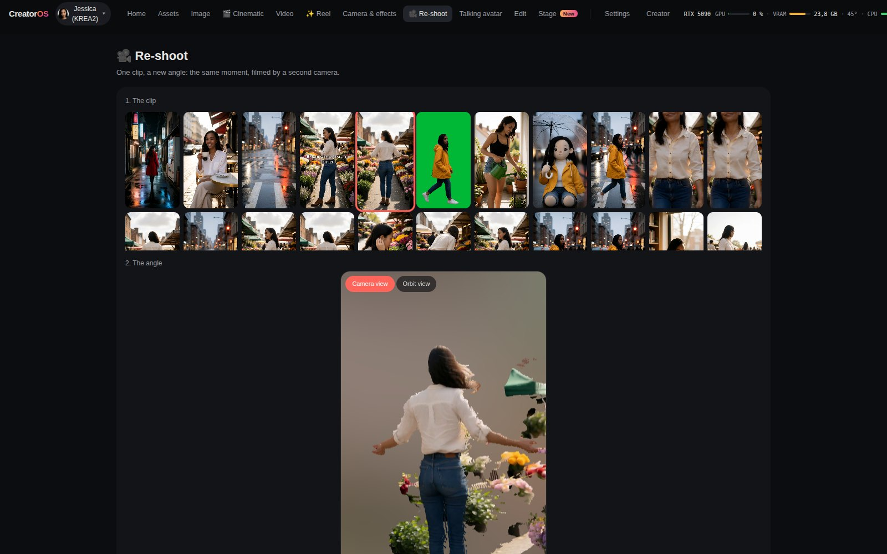

# CreatorOS Studio

A self-hosted creative studio for one recurring character, from a one-line brief to a finished reel: photos, carousels, image-to-video, one-click camera moves and effects, talking avatars, motion transfer, brush retouching and a built-in video editor. It runs on top of a local [ComfyUI](https://github.com/comfyanonymous/ComfyUI), on your own GPU, using open-weights models only. Running on Comfy Cloud with your own key is experimental: the path is wired but not yet verified end to end (Comfy only issues API keys to paid accounts).



Built for the Comfy **#OpenSourceHiggsfield** challenge.

- **Demo video (1:59)**: https://youtu.be/axHdAXHv3Kk
- **Try it**: https://forge.taila06702.ts.net:8443 — the public demo runs on the author's own GPU, one render at a time, 12 images or clips per hour per visitor.
- **Run it yourself**: see [Install](#install).

CreatorOS Studio is the public, general-audience edition of a production tool used daily. It keeps the production recipes and the operator workflow. Private content and the original character are not included.

## What it does

- **One-click reel**: write a brief ("a Sunday morning in Paris, golden light"). A local LLM plans 3 to 6 shots of one session (same outfit, place and light), the character is photographed shot by shot, each shot is animated with sound (LTX-2.5), and the reel is edited automatically with fades, an opening hook and music. The edit stays open in the editor. Not happy with one shot? Redo only that one, with a new motion: the other clips stay and the reel is re-edited by itself.
- **Camera & effects gallery**: 25 one-click presets on any photo: dolly in and out, jib up and down, side tracking, orbit, arc, crash zoom in and out, bullet time, dolly zoom… and viral effects (squish, inflate, cakeify, explode, robot reveal…). Camera moves use the LTX-2 camera LoRAs on LTX-2.5; the others use Remade-AI and ostris LoRAs on Wan 2.1. Jib down is chained in two renders: a jib up from the photo, then a Wan 2.2 first-and-last-frame move from its last frame back down to the photo.
- **Cinematic Studio**: a shot card instead of a prompt. Pick the camera body, lens, focal length and aperture, the framing, the light, the film stock, the look and the grade, add a colour palette (or pull one from a photo), start from a starter shot. Takes ×1 to ×4, or the same shot under four lights on the same seed. Your character plays the scene on Krea 2 or FLUX.2 Klein; any take animates in one click.
- **Stage**: place people and blocks in a top view, set where the camera starts and ends, say what the shapes become. The server draws a grey layout from those numbers, Qwen Edit paints the first frame, and LTX-2.5 with Lightricks' Layout-to-Render IC-LoRA turns it into a finished shot that follows the blocking.
- **Seamless loop**: one photo as first and last frame on Wan 2.2. Each loop gets a measured seam score.
- **Transparent background**: SAM3 keeps the person, a photo comes out as a PNG with alpha and a clip as a WebM with alpha, nothing is redrawn.
- **Sharpen to 1080p**: SeedVR2 3B takes any clip up to 1080p, motion unchanged (about 2 min for 4 s on a 5090).
- **Next shot**: from one photo, Coverage makes a wide, a ¾ and a close-up, Push in moves closer, Next beat imagines the moment after.
- **Re-shoot**: pick a clip, pick an angle (left, right, three-quarter, high, low, or a sweep, descend or orbit move) and get the same moment filmed by a second camera, with the original sound. MoGe-2 reads the clip's geometry, the CrossViewWarp node reprojects it into the new view, and LTX-2.5 with the CrossView-Warp IC-LoRA fills in what the first camera never saw.
- **Talking avatar**: one photo plus a voice (an audio file or the microphone, up to 20 s); the character speaks with lips in sync (InfiniteTalk on Wan 2.1, chained block by block to the length of the audio). Or just type the line: LTX-2.5 makes the voice and the lip movement in a single 4 to 8 s render, no audio file needed (works best on a close shot).
- **Editor**: put library clips and photos on a timeline, trim them with the mouse, crop each shot, add cuts, crossfades or fades to black, text per shot and music, with a global timeline and a playhead. Between two shots, a **generated transition**: Wan 2.2 draws a continuous passage from the last frame of one shot to the first frame of the next, and the clip is inserted between them. Export renders on the CPU with ffmpeg as a library asset.
- **Photo**: text-to-image with Krea 2 (FLUX.2 Klein 9B and MOSS Image optional). A local LLM (Ollama) rewrites the prompt first.
- **Angles and looks on a photo**: one click shows the same photo from another camera position (¾ left or right, profile, from behind, high or low angle, wide, close-up) with the fal Multiple-Angles LoRA on Qwen-Image-Edit-2511, or turns it into one of 24 one-click looks (golden hour, night, burning sunset, film grade, skin retouch, pro headshot, beauty ad, plush toy, figurine, mascot, toy bricks, glitter sticker, comic, pixel art, clay, melting doodle, 60s café, giallo, movie poster, billboard, cloud surf, among animals, storm creature, evening outfit).
- **Light and frame on a photo**: seven one-click relights (left, right, window, studio, blue hour, neon, candle), and Expand widens a photo to 16:9, 9:16, 4:5, 1:1 or +30%: the edges are redrawn with Qwen-Image-Edit and the original photo stays untouched in the middle.
- **`@` in the prompt**: type `@` to pull in a character, outfit, place, pose or style. Picking a character makes it the active one.
- **Film a move on your phone** (owner only): scan a one-time QR code, film, and the clip lands in Motion as the source. The link expires after 10 minutes and takes one video.
- **Carousels**: from one anchor photo, the app plans a coherent set of shots (same character, same light, varied framing) and renders them as a batch.
- **Image-to-video**: Wan 2.2 I2V A14B or LTX-2.5 22B (with audio). Each engine has a quick low-resolution draft mode.
- **Motion transfer**: animate a still with the movement of a driver video (Wan Animate 2).
- **Mix (character swap)**: give it a video, and your active character takes the place of the person in it, in the same setting and with the same moves. The studio picks the sharpest early frame, reads the outfit with the vision model, renders your character full-body in that outfit, then WanAnimate 2.2 does the replacement (SAM2 mask placed by GroundingDINO) with the character's Wan identity LoRA. A long video can start at any second of it, and every Mix states that the character stays fully clothed and refuses nudity.
- **Shot-by-shot rendering**: a driver video that contains cuts is split automatically at each cut. Every shot is rendered on its own, then the montage is rebuilt at the exact original durations. Rendering a multi-shot source in one block freezes the first shot's state; rendering per shot follows the source.
- **Brush retouch, photo and video**: paint a zone and describe the change. Only that zone is regenerated, and the rest stays byte-identical on photos. On video, the zone is either tracked frame to frame by SAM3 or kept fixed in the frame. The result opens in a before/after slider. No brush needed on video either: name an element ("dress") and say what it becomes, or **change the background**: SAM3 finds and tracks the person, and everything around them is redrawn from your description while their motion stays untouched. **Green screen**: SAM3 tracks the person and everything else turns solid green, nothing redrawn. **Remove** people, passers-by or vehicles from a clip: the official LTX-2.5 Clean-Plate IC-LoRA by Lightricks rebuilds the empty scene behind them, camera move and original sound kept (about 2 min for 4 s).
- **Automatic clip check**: after every video render, the studio measures the clip in about a second, on the CPU: black frames, frozen video, a jump inside the shot, smear, and how close the face stays to the start image (OpenCV YuNet + SFace). A serious defect (black, frozen, jump, long smear) re-shoots the clip once with another seed. Both takes stay in the library, the one with fewer defects stays in front and the other is greyed out. Face drift and short blur are shown as warnings with the exact second. Re-shoot, avatar, video retouch and clean-plate clips are checked too, with warnings only.
- **Live preview** of the latent while a render is running (desktop and mobile).
- **Library**: review (approve/reject), folders, trash with restore, provenance of every render (recipe, seed, LoRAs, final prompt), and thumbnails for every grid. Every render can be downloaded as the **exact ComfyUI workflow** it ran (API format, server paths stripped) with the models it loads and their licences, to open it in ComfyUI and keep going there.
- **Diagnostics**: GPU/VRAM state, ComfyUI link watchdog, missing nodes and models per recipe, and a one-click **bug report log** (version, system, recent failures, browser errors, no private data) to paste into a GitHub issue.

Desktop UI (`src/v2`) and a mobile UI (`src/m`) are served by the same backend; the mobile Studio space carries the reel, camera & effects, talking avatar and editor views. The interface is in French and English.

## Screenshots

| | |
|---|---|
|  |  |
| **Stage**: block a shot from above, set the camera, get a finished shot | **Viewer**: full recipe, seed, render time, checks, ComfyUI workflow, reopen in Stage |
|  |  |
| **Camera & effects**: pick a move, pick a photo | **One-click reel**: brief, shots, clips, edit |
|  |  |
| **Editor**: timeline, trims, crossfades, text, music | **Talking avatar**: one photo, one voice |
|  |  |
| **Cinematic Studio**: a shot card instead of a prompt, same shot in four lights | **Re-shoot**: the same moment from a new camera angle, previewed in 3D |
|  | |
| **Mix**: drop in a video, your character takes the person's place | |


## Architecture

```
browser (desktop / mobile)
        │  HTTP
        ▼
Node (Fastify) server  ── server/          job queue, recipes, persona, SQLite
        │  HTTP + WebSocket
        ▼
ComfyUI (local)        ── workflows/       API-format recipes, patched per job
        │
Ollama (local)         prompt rewriting, captions, light vision checks
```

- **Recipes** are ComfyUI workflows in API format (`workflows/PROD_*.json`). The server loads a recipe, patches it for the job (prompt, seed, size, LoRAs, masks), then submits it. Patching happens in memory: a job never changes a recipe file. To swap in your own graph, open **Settings → Recipes & texts**, pick the recipe, click **Import an API workflow** and choose a ComfyUI export made with *Save (API)*. The file is loaded into the editor for review, and saving it validates the graph and backs up the previous version to `.backups/`. The *Review* panel then shows which inputs the server drives and which nodes or models are missing.
- **Shaping texts** (the rewriter system prompts, captions) live in `prompts/`. They are read at every job, so you can edit them without a restart.
- **Data** (SQLite database, renders, thumbnails) lives outside the repository, in `~/creatoros-data` by default.

## Requirements

- An NVIDIA GPU. The production machine uses a 32 GB card and the full-size recipes are sized for it; on 12 and 16 GB cards the photo recipes run with lighter weights (see [Smaller GPUs](#smaller-gpus)).
- Node.js 22.5 or newer (the server uses the built-in `node:sqlite`) and ffmpeg.
- [ComfyUI](https://github.com/comfyanonymous/ComfyUI), recent enough to ship the Wan Animate 2, LTX-2.5 and SAM3 core nodes, plus these custom node packs:
  ComfyUI-KJNodes, ComfyUI-VideoHelperSuite, ComfyUI-GGUF, ComfyUI-CrossViewWarp (re-shoot), ComfyUI-WanVideoWrapper + ComfyUI-segment-anything-2 + comfyui_controlnet_aux + comfyui_segment_anything (Mix), ComfyUI-Frame-Interpolation (RIFE, for video refine and smoothing), RES4LYF, ComfyUI-Impact-Pack + Impact-Subpack (only for photo HD).
- [Ollama](https://ollama.com) with a text model (default `mistral-small`) and a vision model (default `qwen2.5vl:7b`).

### Models

Each recipe names its model files. Open the JSON to see exactly what it loads. The main ones:

| Recipe | Models |
|---|---|
| `PROD_gen_krea_sfw.json` | Krea 2 turbo, Qwen3-VL 4B text encoder, Qwen-Image VAE |
| `PROD_gen_sfw.json` | FLUX.2 Klein 9B, Qwen3 8B text encoder, FLUX.2 VAE |
| `PROD_gen_moss_sfw.json` | MOSS Image SFT (int8), Qwen3.5 9B text encoder, FLUX.2 VAE. Apache-2.0, no identity LoRA, needs a ComfyUI from late October 2026 or newer |
| `PROD_edit.json` | Qwen-Image-Edit 2511, Qwen2.5-VL 7B, Qwen-Image VAE |
| `PROD_video_wan*.json` | Wan 2.2 I2V 14B high/low noise, UMT5-XXL, Wan 2.1 VAE, lightx2v 4-step LoRAs |
| `PROD_video_wan_t2v.json` | Wan 2.2 T2V 14B high noise (fp8) and low noise (GGUF Q8), UMT5-XXL, Wan 2.1 VAE, lightx2v T2V LoRA |
| `PROD_video_ltx_hq.json` | LTX-2.5 22B distilled, Gemma text encoder, LTX video/audio VAEs, spatial upscaler |
| `PROD_motion_*.json` | Wan Animate 2, UMT5-XXL, CLIP Vision H, Wan 2.1 VAE, lightx2v distill LoRA |
| `PROD_wananimate_mix.json` | Wan 2.2 Animate 14B (fp8, Kijai), UMT5-XXL, CLIP Vision H, Wan 2.1 VAE, lightx2v distill LoRA, SAM2, DWPose, GroundingDINO |
| `PROD_v2v_refine*.json` | Wan 2.2 T2V A14B low noise (GGUF Q8), SAM3.1 for tracked zones |
| `PROD_video_wan21_effets.json` | Wan 2.1 I2V 14B 480p (fp8), UMT5-XXL, CLIP Vision H, Wan 2.1 VAE, lightx2v I2V 480p LoRA; effect and camera LoRAs added at render time |
| talking avatar (built in `server/jobs.js`) | Wan 2.1 I2V 14B 480p, InfiniteTalk single-speaker patch, wav2vec2 Chinese base audio encoder, lightx2v I2V 480p LoRA |
| re-shoot (built in `server/jobs.js`) | MoGe-2 ViT-L (geometry), LTX-2.5 22B distilled with the CrossView-Warp v2 IC-LoRA, Gemma text encoder, LTX video/audio VAEs, spatial upscaler |

Preset LoRAs (licences in `server/presets.js` and `scripts/installer/modeles.json`): LTX-2 19B camera control by Lightricks (LTX-2 Community License), camera and effect LoRAs by Remade-AI and the dolly zoom by ostris (Apache-2.0). The LTX-2 camera LoRAs load on LTX-2.5 unchanged. Re-shoot uses the [CrossView-Warp v2 IC-LoRA](https://huggingface.co/Cseti/LTX2.3-22B_IC-LoRA-CrossView-Warp_v2) and the [ComfyUI-CrossViewWarp](https://github.com/cseti007/ComfyUI-CrossViewWarp) node by Cseti (Apache-2.0), trained on LTX-2.3 and loading on LTX-2.5, and [MoGe-2](https://huggingface.co/Comfy-Org/MoGe) (MIT). The MiniMax H3 port of that LoRA is not used: its licence excludes the EU, the UK and the US.

## Install

```bash
git clone <this repo> creatoros-studio && cd creatoros-studio
npm run setup          # interactive wizard, see below
npm ci
npm run build          # type-check, build the front, precompress assets
npm start              # serves http://127.0.0.1:8787
```

ComfyUI is expected at `http://127.0.0.1:8188` and Ollama at `http://127.0.0.1:11434`.

### Setup wizard

`npm run setup` (plain Node, no extra dependency) walks through the machine and asks before every step that writes anything:

1. **Prerequisites**: Node 22.5+, git, ffmpeg, Python 3.12 (uv if present), NVIDIA driver and VRAM, with a fix hint for each missing piece.
2. **ComfyUI**: found through `COMFY_DIR`, `~/ComfyUI` or a path you give. If absent, it can clone it, create a venv (uv or `python -m venv`), install a CUDA build of PyTorch matching your driver, then the requirements. It checks that ComfyUI is recent enough for the core nodes the recipes use.
3. **Features**: pick what you want to run (photo, Klein, photo HD, edit, Wan, Wan T2V, LTX, motion, video retouch). Each group shows what is missing, its size, and an estimate of the VRAM it needs against your card (fits, tight, or likely too big).
4. **Custom node packs** the selected groups need, cloned into `custom_nodes/` with their requirements installed into ComfyUI's venv (torch lines are skipped so your CUDA build stays).
5. **Models**: downloaded into `models/` (or the default folder of your `extra_model_paths.yaml`), with progress and resume. Files are written as `.part` and renamed when complete.
6. **Ollama**: checks the service and offers `ollama pull` for `CREATOROS_LLM` and `CREATOROS_VLM_DESCRIBE`.
7. **Character**: optionally creates `<CREATOROS_DATA>/persona.json` from the example.

```bash
npm run setup -- --check         # report only, change nothing (alias --dry-run)
npm run setup -- --verify-urls   # HEAD every model URL, compare sizes, no download
npm run setup -- --comfy ~/ComfyUI --groups photo,video_wan
```

The model list lives in `scripts/installer/modeles.json` (target folder, URL, size, licence, recipes). The wizard re-reads `workflows/PROD_*.json` on every run and warns about any model a recipe loads that the manifest does not know. FLUX.2 Klein and LTX-2.5 come from gated Hugging Face repos: accept the licence on the model page, then `export HF_TOKEN=...` before running setup. The token is only sent as an `Authorization` header to huggingface.co, never printed or written. Restart ComfyUI after new node packs are installed.

### Smaller GPUs

The recipes stay the same on a smaller card; only the weights change. Below 24 GB, the studio swaps each heavy model loader for a lighter version of the same model just before the graph goes to ComfyUI: FLUX.2 Klein 4B instead of 9B, with its 4B text encoder. Video is not there yet: Wan 2.2 A14B as GGUF Q4 ran out of memory on the same 12 GB test at the recipe's resolution, so it is not listed. A variant is used only when its file is installed; otherwise the original runs and ComfyUI offloads it, more slowly. Krea 2 (13 GB) has no smaller version, so under 14 GB the default photo engine becomes FLUX.2 Klein. Character LoRAs trained on Klein 9B do not apply to the 4B, so on a 12 GB card a character keeps her look only through the prompt.

The profile (24, 16, 12 or 8 GB) comes from the card ComfyUI reports, or from `CREATOROS_VRAM`. The setup wizard reads the same profile and downloads only the light files your card needs (`npm run setup -- --vram 12` to size it for another card, `--keep-full` to also keep the originals). The machine panel shows the profile and which light weights are installed. The variants live in `scripts/installer/modeles.json` (`leger` entries), one list for the wizard and the server.

Only variants that passed the lab are listed. [docs/LAB.md](docs/LAB.md) gives the real render time and peak VRAM of each recipe, full-size on a 32 GB card and light on a ComfyUI limited to about 12 GB.

### Configuration

All settings are environment variables. The main ones:

| Variable | Default | |
|---|---|---|
| `CREATOROS_PORT` / `CREATOROS_HOST` | `8787` / `127.0.0.1` | HTTP server |
| `CREATOROS_DATA` | `~/creatoros-data` | database, renders, thumbnails, `persona.json` |
| `COMFY_URL` | `http://127.0.0.1:8188` | ComfyUI |
| `COMFY_DIR` | `~/ComfyUI` | used to locate `input/` and `output/` |
| `COMFY_INPUT` / `COMFY_OUTPUT` | `$COMFY_DIR/input` / `output` | |
| `CREATOROS_LORAS` | `$COMFY_DIR/models/loras` | LoRA folder listed in the UI |
| `OLLAMA_URL` | `http://127.0.0.1:11434` | |
| `CREATOROS_LLM` / `CREATOROS_VLM_DESCRIBE` | `mistral-small:latest` / `qwen2.5vl:7b` | |
| `CREATOROS_PHOTO_ENGINE` | `krea` | `krea` or `klein` |
| `CREATOROS_OWNER_KEY` | unset | locks the studio for a public demo, see below |
| `CREATOROS_NOTIF_URL` | unset | [ntfy](https://ntfy.sh) topic URL: the owner is notified when an Internet visitor starts a render, and when one fails or is refused |

### Your character

The studio is built around one recurring character, described in `<CREATOROS_DATA>/persona.json` (copy `persona.example.json`):

```json
{
  "name": "Ava",
  "trigger": "ava_token",
  "description": "Fictional travel and lifestyle creator.",
  "preamble": "a 30-year-old woman with short auburn hair",
  "loras": [{ "name": "ava_krea.safetensors", "strength": 1.0 }],
  "videoLoras": []
}
```

The server stacks the character's LoRAs onto each job at render time; the recipes themselves contain none. Without a `persona.json`, the app runs on the base models with no trigger word. Each field can also be set by environment variable (`CREATOROS_PERSONA_NAME`, `_TRIGGER`, `_DESCRIPTION`, `_PREAMBLE`, `_LORAS` as `file[:strength],…`). The file is re-read when it changes.

Only use a character you own: a fictional one you created, or yourself.

### Public demo

Set `CREATOROS_OWNER_KEY` to a long random string before opening the studio to visitors. With a key, the Creator page, the characters and their wardrobe, LoRA uploads, profile photos, recipes and shaping texts are read-only: those writes answer 403 unless the request carries the exact key in an `X-Owner-Key` header. The owner enters the key once in Settings → Comfy Cloud; it stays in that browser. Visitors keep rendering, reviewing, editing and exporting. Without a key nothing is locked, which suits a single-user install.

Internet visitors (anyone without the key and outside the tailnet) are limited to 12 images or clips per hour each (a ×4 take counts as 4, a one-click reel as about 10), and are turned away while the public queue holds 8 jobs. A queued job shows its rank and an estimated start time. Settings → Comfy Cloud gives the owner a daily count of visitors, page views and renders, which keeps nothing personal: a visitor is a salted hash that changes every day. It also lists the latest visitor renders with their outcome and failure cause.

Visitors can only start from images the studio generated itself. Uploading photos, videos, voices or music is owner-only, and the server refuses any job that points at an uploaded file, even when the request is crafted by hand. Every text a visitor sends is checked raw, before the LLM rewrites it, and again after rewriting. Anything that refers to a child or a minor age is refused (English and French, ages in digits or words, disguised spellings), along with sexual content. A visitor refused for this is blocked from rendering for the rest of the day, and the owner is notified.

ComfyUI's `input/` folder may be shared with another install on the same machine. The studio keeps a register of the files it put there itself: the source picker only lists those, and a job or an image description that names any other file is refused. No JSON response shows the server's home folder; it is replaced by `~`.

### Use it from a terminal or an AI agent

The studio has a command line and an MCP server. Both talk to a running studio over its HTTP API, so the same rules apply as in the web UI: content filter, render queue, visitor limits.

```bash
npm run studio -- photo "a woman reading by a sunny library window, candid" --wait --out ./renders
npm run studio -- video <libraryId> "she turns a page, slow push-in" --wait
npm run studio -- reel "Sunday morning at a flower market" --shots 4 --wait --out ./renders
npm run studio -- status <jobId|reelId>
npm run studio -- library --n 5 --json
```

`--json` prints one JSON object per result, for scripts and agents. To let Claude Code, Claude Desktop, Cursor or any MCP client drive the studio:

```bash
claude mcp add creatoros-studio -- node /path/to/creatoros-studio/scripts/agent/mcp.mjs
# or, after `npm link` in the repo: claude mcp add creatoros-studio -- creatoros-studio-mcp
```

The MCP server exposes `generate_photo`, `image_to_video`, `make_reel`, `get_status`, `list_library`, `list_characters` and `machine_status`. It has no dependency beyond Node. Set `STUDIO_URL` if the studio is not on `http://127.0.0.1:8787`, and `CREATOROS_OWNER_KEY` if it is locked with an owner key. Without the key, a request from the same machine is treated like any visitor.

## Community

Shared on Reddit the week of the submission (numbers as of 28 October 2026):

| Community | Views | Upvotes | Comments | Shares |
|---|---|---|---|---|
| r/comfyui | 34,000 | 98 | 27 | 45 |
| r/StableDiffusion | 22,000 | 43 | 14 | 12 |
| r/OpenSourceAI, r/SelfHostedAI | 1,000 | 3 | 1 | 0 |

What people asked for, and what changed because of it:

- **"Can you swap your own workflows in?"** → Settings → Recipes & texts now has an *Import an API workflow* button (see Architecture).
- **"What about 8 GB of VRAM?"** (the most upvoted question) → lighter presets for smaller cards are the next step; until then the README says plainly that the recipes are sized for 32 GB.
- **"Does it run on several GPUs?"** → one studio per GPU works today (each with its own port, data folder and ComfyUI); a single queue feeding several cards is planned.
- **"The provenance tracking alone is a killer feature"** → every render keeps its recipe, seed, LoRAs and final prompt, and now also its automatic clip check.

A fork built around reference-driven video has been announced. Forks are welcome: the license is Apache-2.0, keep the notice and a credit.

## Content policy

This edition is general-audience only. Every job runs with a single SFW register, the rewriter instructions keep the character fully clothed, and a blocklist (`server/t0.js`) rejects prompts and captions with forbidden terms before anything reaches the GPU. Every render of a character also states that she is an adult woman in her mid-twenties, so a prompt that names no person cannot drift towards a younger-looking figure.

## Characters in the demo

The demo video and screenshots use fictional AI characters whose LoRAs are published on Civitai under licences that allow it: **Mila**, LoRA by [Solricks](https://civitai.com/models/2809908), and **Aisha**, LoRA by [KelevraQuakenstein](https://civitai.com/models/2327289) (credit required). **Ava** was created in the app for the video, with no LoRA. No real person's likeness is used.

## License

Apache License 2.0, see [LICENSE](LICENSE). Models, ComfyUI and custom node packs keep their own licenses.
