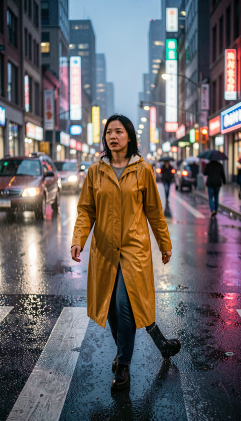
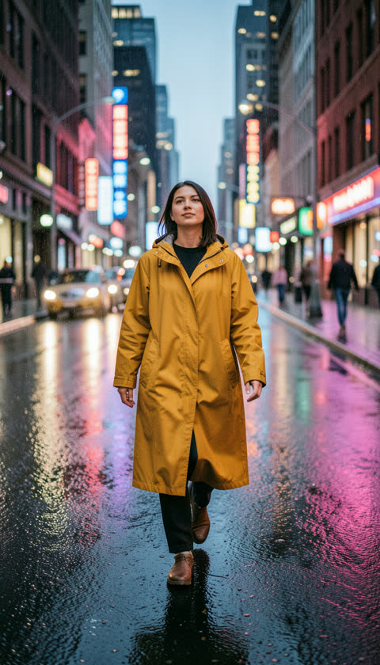

# Lab: real render times and peak VRAM

Every recipe rendered once with the same prompt and seed (2026-11-10, NVIDIA GeForce RTX 5090, 32607 MiB). Before each run ComfyUI unloads every model, so the peak is the recipe alone. On a large card ComfyUI keeps the text encoder and the model resident together, so these peaks are higher than what the recipe strictly needs.

The "16 / 12 / 8 GB card" rows replay the exact same graph with the light weights on a second ComfyUI that is held to the size of that card (`scripts/bancs/comfy-bride.py`): PyTorch may not allocate more than the card holds, and ComfyUI is told only that much is free, so it offloads exactly as it would on the real card. Their peak is that ComfyUI process alone, CUDA context included. Finishing there means the recipe runs on a card of that size. On an 8 GB card the studio renders Wan video at 480p (long side 832): the Q4 weights fit, the 720p activations do not. Scripts: `scripts/bancs/labo-petite-carte.mjs` (photo) and `scripts/bancs/labo-video-petite.mjs` (video).

Prompt: *A woman in a mustard raincoat crossing a rainy city street at dusk, neon reflections on wet asphalt, candid street photo, 35mm*. Videos start from the Krea 2 photo, 4 s: *she walks forward under the rain and glances to the side, slow tracking shot*.

| Recipe | Render time | Peak VRAM | Result |
|---|---|---|---|
| Photo · Krea 2 | 18.6 s | 19.3 GB |  |
| Photo · FLUX.2 Klein 9B | 6.7 s | 17.9 GB |  |
| Image to video · Wan 2.2 A14B fp8 | 224.7 s | 25.3 GB |  |
| Image to video + sound · LTX-2.5 22B | 110.2 s | 29.6 GB |  |
| Photo · FLUX.2 Klein 9B (16 GB card) | 7 s | 15.5 GB |  |
| Image to video · Wan 2.2 A14B GGUF Q4 (16 GB card) | 280 s | 14.7 GB |  |
| Photo · FLUX.2 Klein 4B (12 GB card) | 7.1 s | 9.3 GB |  |
| Image to video · Wan 2.2 A14B GGUF Q4 (12 GB card) | 281.1 s | 11.1 GB |  |
| Photo · FLUX.2 Klein 4B (8 GB card) | 7.8 s | 7.8 GB |  |
| Image to video · Wan 2.2 A14B GGUF Q4, 480p (8 GB card) | 92.4 s | 6.9 GB |  |

Reproduce: `node scripts/bancs/labo.mjs` with the studio running. The small-card rows use the light weights the setup wizard installs for small cards (`npm run setup -- --vram 8`), which the studio swaps in automatically on a small card.
